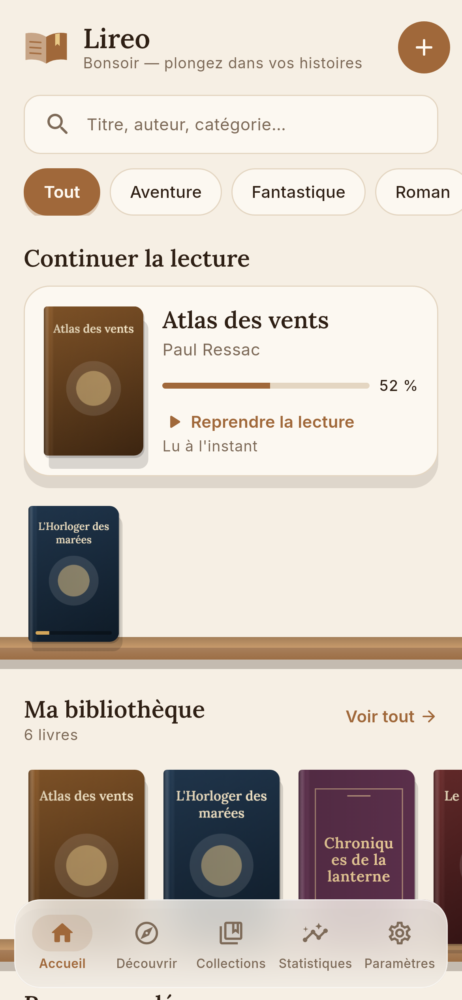
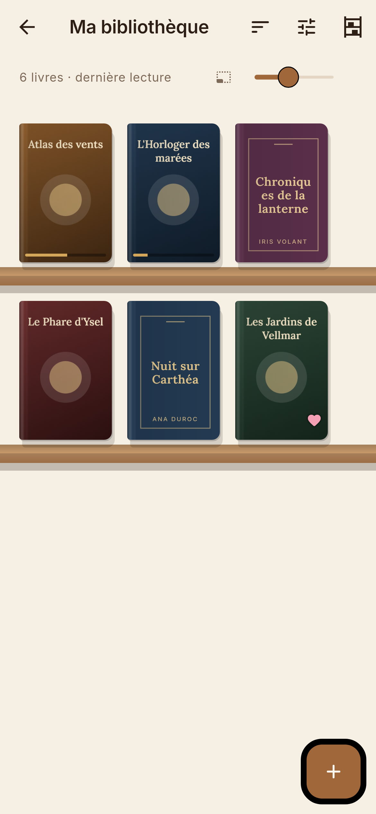
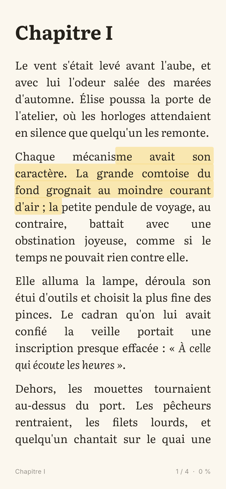
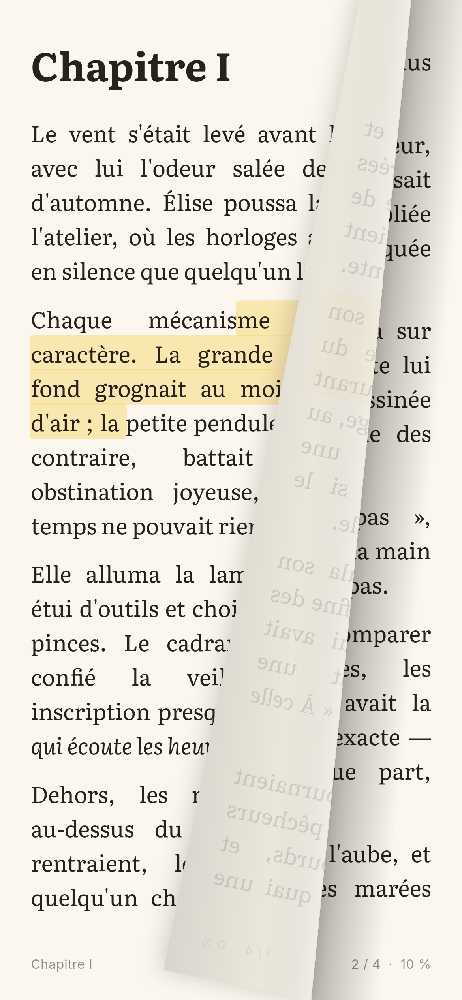
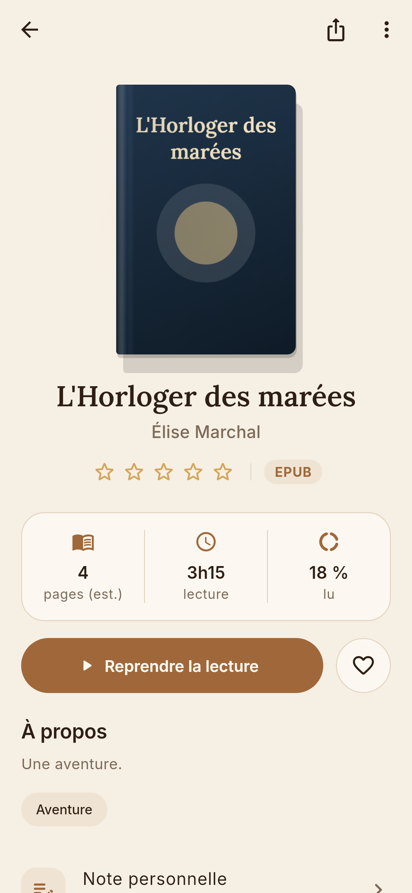
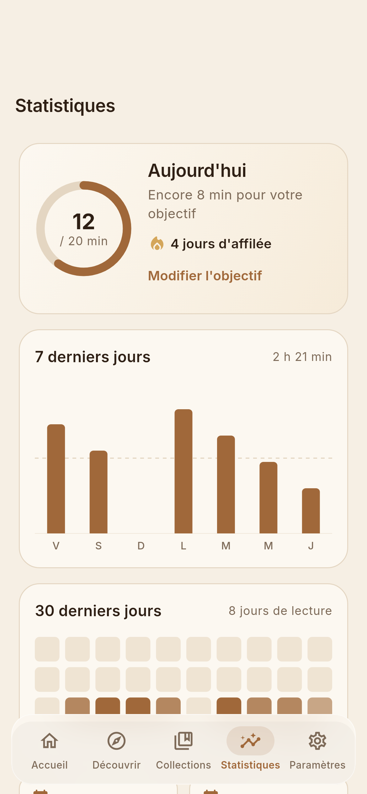
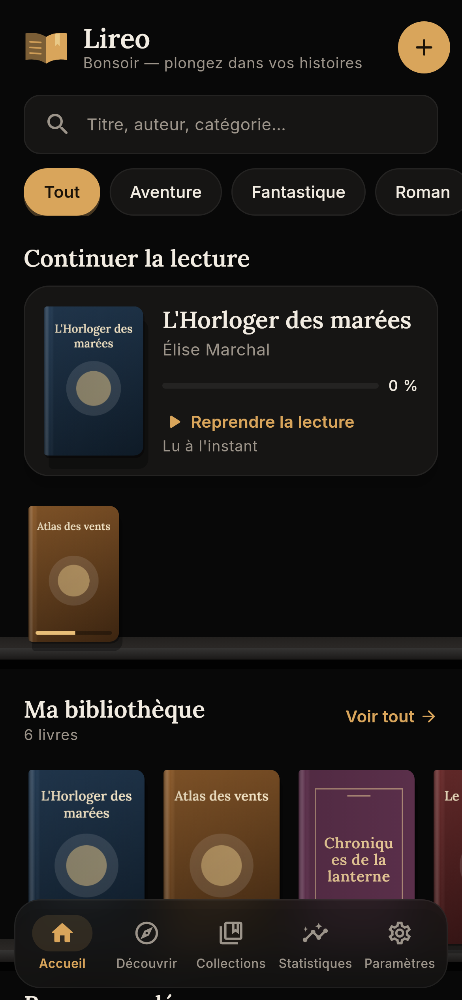
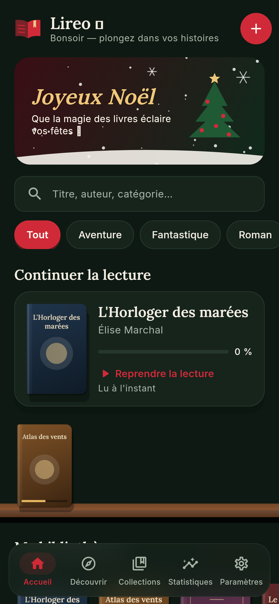

<p align="center">
  
</p>

<h1 align="center">LIREO</h1>

<p align="center">
  <b>Le lecteur eBook élégant, hors ligne, sans publicité et sans pistage.</b><br>
  EPUB · PDF · MOBI/AZW3 · FB2 · DOCX · ODT · TXT · Markdown · HTML · CBZ
</p>

<p align="center">
  
  
  
  <a href="../../releases/latest"></a>
</p>

---

## Présentation

LIREO réunit votre bibliothèque et un moteur de lecture natif pensé pour le confort :
mise en page typographique soignée, Page Curl réaliste, thèmes jour/nuit/sépia, surlignages
et notes, synthèse vocale et statistiques de lecture. Tout reste sur votre téléphone ;
la synchronisation Dropbox / Google Drive est facultative.

<p align="center">
  
  
  
  
</p>
<p align="center">
  
  
  
  
</p>

## Points forts

- 📚 **Bibliothèque** : étagères, grille ou liste ; import de dossiers entiers, anti-doublons, couvertures et métadonnées automatiques, collections (privées protégées par PIN), favoris.
- 📖 **Lecture** : moteur natif sans WebView, pagination ou défilement continu, double page, Page Curl, 7 fonds + couleurs perso, polices embarquées ou importées, zones de tap et touches volume configurables.
- 📝 **Notes de bas de page** : un tap sur un appel de note affiche la définition dans une fenêtre aux couleurs du thème, sans quitter la page.
- 🖍️ **Annotations** : surlignage 5 couleurs, notes, marque-pages, recherche plein texte, export Markdown.
- 🔊 **Synthèse vocale** avec suivi mot à mot, minuteur de sommeil.
- 📊 **Statistiques** : temps de lecture, séries, objectifs, rappel quotidien, widget Android « Livre en cours ».
- 🔒 **Confidentialité** : aucune publicité, aucun traqueur, PIN + biométrie, sauvegarde JSON locale.
- 🎨 **Thèmes** : 6 thèmes + personnalisé, mode OLED, thèmes saisonniers automatiques.

## Télécharger

Le dernier APK Android est disponible dans les [Releases](../../releases/latest).
Autorisez l'installation depuis des sources inconnues, puis ouvrez le fichier `.apk`.

## Compiler depuis les sources

Prérequis : Flutter 3.50 (Dart 3.14), SDK Android 35/36.

```bash
git clone https://github.com/Delaruno20/LIREO.git
cd LIREO
flutter pub get
flutter run                      # appareil Android/iOS connecté, ou -d linux
flutter build apk --release      # APK dans build/app/outputs/flutter-apk/
flutter test                     # tests unitaires
flutter test test_screens/screens_test.dart --update-goldens   # régénère les captures
```

### Mesures de performance (téléphone, mode profile)

```bash
flutter drive --profile -d <appareil> --driver=test_driver/perf_driver.dart --target=integration_test/perf_test.dart
```

Génère 300 EPUB, un EPUB de 60 chapitres illustrés et un PDF de 400 pages, puis mesure import,
défilement, pagination, ouverture, Page Curl et PDF. Rapport : `build/perf/`.
**Attention : `flutter drive` désinstalle l'app à la fin → ses données sur l'appareil sont
effacées.** Exporter une sauvegarde avant, ou utiliser un appareil de test.

## Architecture

```
lib/
├─ app/            démarrage, injection des services (provider), routes
├─ core/
│  ├─ design/      design system : palette sémantique (ThemeExtension), tokens, thème M3
│  ├─ widgets/     couverture 3D, étagère, verre dépoli, micro-interactions
│  └─ errors.dart  gestion centralisée des erreurs + journal
├─ data/
│  ├─ db/          SQLite (sqflite), migrations versionnées
│  ├─ models/      Book, BookLocation, Annotation, Collection, ReadingSession
│  ├─ repositories/ bibliothèque, annotations, statistiques (flux de changements)
│  └─ settings/    préférences (SharedPreferences), PIN haché + salé
├─ formats/        ← moteurs de formats, isolés de l'UI
│  ├─ document/    modèle commun FlowDocument + convertisseur HTML
│  ├─ adapters/    EPUB, MOBI/AZW3/PRC, FB2, DOCX/ODT, TXT, Markdown, HTML, CBZ
│  └─ format_registry.dart   seul point d'entrée : extension → moteur
├─ services/       import (copie + SHA-1 + métadonnées en isolate), polices, verrou, sauvegarde
└─ features/       écrans : accueil, bibliothèque, découvrir, collections, fiche, lecteur,
                   statistiques, paramètres, onboarding, sécurité
```

**Ajouter un format** = écrire un adaptateur qui produit des `FlowChapter` (texte) ou un
`ImageBook` (images), puis l'enregistrer dans `FormatRegistry`. Rien d'autre ne change.

### Moteur de lecture (reflowable)

Rendu natif Flutter, sans WebView :

1. L'adaptateur convertit le fichier en blocs (`TextBlock`, `ImageBlock`, `RuleBlock`).
2. `Paginator` met chaque paragraphe en page **une seule fois** (`TextPainter`), puis découpe
   ligne à ligne : un paragraphe à cheval sur deux pages garde la même justification.
3. Les positions sont des offsets de caractères (`BookLocation`) : elles survivent aux
   changements de police, de marges ou de taille d'écran.
4. Chaque page est enregistrée en `ui.Picture` → animations (Page Curl, glissement, fondu)
   fluides, sans recalcul.
5. Seuls ~4 chapitres paginés restent en mémoire (LRU) ; les voisins sont préchargés.

## État des fonctionnalités

| Domaine | Fait | Pas encore |
|---|---|---|
| Formats | EPUB 2/3, PDF (PDFium), MOBI/PRC/AZW3 non chiffrés (PalmDOC), FB2, DOCX, ODT, TXT, Markdown, HTML, CBZ, images | DJVU, CHM, CBR/RAR, RTF, UMD, MHT, OPDS ; compression HUFF/CDIC ; FB2 en windows-1251 |
| Bibliothèque | import natif + gestionnaire de fichiers (dossiers récursifs), anti-doublons SHA-1, métadonnées et couvertures en arrière-plan, étagères/grille/liste, taille des couvertures, tri, filtres, recherche instantanée, sélection multiple, édition des métadonnées, collections (privées), favoris | — |
| Lecteur | pagination, défilement continu + automatique, double page, Page Curl/slide/fade/aucune, typographie complète, 7 fonds + couleurs perso, polices importées, réglages par livre, profils par format (export/import), zones de tap configurables, luminosité au glissement, pincement = taille, touches volume/flèches/média, TOC, recherche, marque-pages, surlignage 5 couleurs, notes, copier/partager, export Markdown, liens internes | césure automatique, poignées de sélection, annotations écrites dans le PDF |
| Avancé | synthèse vocale (moteurs système : voix, vitesse, tonalité, suivi mot à mot, paragraphe ±), minuteur, rappel de pause, rappel de lecture quotidien (notification), widget Android « Livre en cours » (reprise en un tap), PIN + biométrie, statistiques complètes, sauvegarde/restauration JSON | raccourcis d'application |
| Synchronisation | Dropbox et Google Drive (dossier réservé à l'app) : progression, annotations, collections, favoris, statistiques, réglages ; fusion par horodatage + suppressions tracées (base v2) | activation : identifiants de développeur à fournir (voir ci-dessous) |
| Dictionnaire / traduction | ouverture du Wiktionnaire / Google Traduction (en ligne, sur action explicite) | dictionnaire hors ligne |

## Sécurité

- PIN haché + salé (SHA-256). Modifier ou supprimer le PIN, désactiver la biométrie, afficher les
  collections privées et restaurer une sauvegarde exigent le PIN actuel (ou la biométrie si activée).
- Temporisation : après 5 codes faux, 30 s d'attente, doublée à chaque nouvel échec (max 15 min).
  Le compteur est persistant (un redémarrage ne le remet pas à zéro). Validation automatique
  uniquement à la longueur exacte du PIN, pour que les préfixes ne servent pas d'essais gratuits.
- « Appareils à proximité » (Android 17, `ACCESS_LOCAL_NETWORK`) : aucun plugin ne la déclare ;
  le système l'accorde d'office aux apps ayant INTERNET. La demande n'apparaissait qu'avec la
  version debug ; la version release ne demande rien au démarrage.

## Performances (Galaxy A17, mode profile)

| Mesure | Avant | Après |
|---|---|---|
| Mémoire (RSS) en fin de parcours | 635 Mo | 414 Mo |
| Mémoire, gros livre ouvert | 699 Mo | 497 Mo |
| Cache d'images | 100 Mo (plein) | 48 Mo (plafond) |
| Ouverture d'un EPUB de 60 chapitres | 375 ms | 289 ms |
| Pire image en reprenant dans un chapitre de 1 Mo | 280 ms¹ | 104 ms |
| Défilement grille, 300 livres (p99) | 28,6 ms | 21,1 ms |
| Défilement étagères (p99 / images > 16,7 ms) | 25,1 ms / 11,3 % | 20,2 ms / 9,8 % |
| Page Curl (p99) | 20,2 ms | 22,7 ms (inchangé, bruit) |
| PDF 400 pages : ouverture / défilement p99 | 64 ms / 26,0 ms | 59 ms / 24,7 ms |

¹ mesuré après le découpage de la pagination, avant le passage en isolate (scénario absent de la
première passe). Optimisations : cache d'images plafonné à 48 Mo ; couvertures décodées à une
largeur arrondie à 64 px (grille, étagères et fiche partagent la même image) ; images d'un chapitre
dédoublonnées ; pagination découpée en tranches de 6 ms ; chapitres EPUB > 150 Ko analysés dans un
isolate. Reste lourd : la pagination elle-même (~90 ms/chapitre, 0,8–0,9 s pour 1 Mo de texte).

## Notes

- **Synchronisation** : Dropbox et Drive restent « non configurés » tant que l'APK n'est pas compilé
  avec vos propres identifiants :
  ```bash
  flutter build apk --dart-define=DROPBOX_APP_KEY=votre_clé --dart-define=GOOGLE_SERVER_CLIENT_ID=votre_id.apps.googleusercontent.com
  ```
  Dropbox : créer une app « App folder » avec l'URI de redirection `lireo://dropbox-auth`.
  Google : créer un client OAuth (Android + Web) avec le scope `drive.appdata`.
- `flutter_local_notifications` est fixé en 22.x (la 23.x exige le SDK 37) ; il requiert `coreLibraryDesugaring`.
- Mémoire Gradle limitée à 2 Go (`android/gradle.properties`) : avec 8 Go la compilation était tuée sur cette machine.

- `MANAGE_EXTERNAL_STORAGE` (gestionnaire de fichiers) est soumis à justification sur le Play Store ;
  le sélecteur natif fonctionne sans.
- `permission_handler` est fixé en 12.x : la 13.x exige le SDK Android 37.
- Polices : Inter, Lora, Literata, Merriweather, Atkinson Hyperlegible (SIL OFL 1.1), embarquées.

## Licence

Code sous licence [MIT](LICENSE). Polices embarquées sous SIL Open Font License 1.1.
